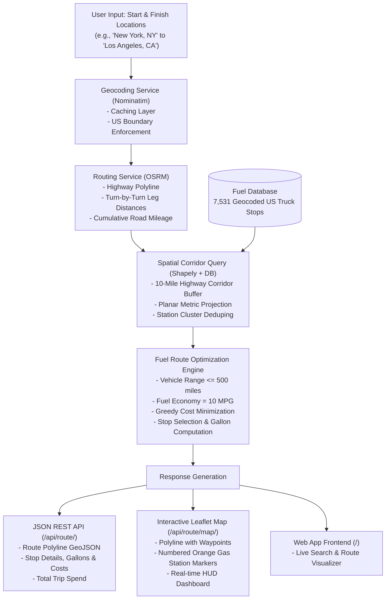

# 🚚 Optimal Fuel Route Planner API (USA)

[](https://python.org)
[](https://djangoproject.com)
[](https://www.django-rest-framework.org/)
[](https://mysql.com)
[](https://project-osrm.org/)
[](https://pytest.org)

An intelligent backend service built with **Django REST Framework (DRF)** that calculates driving routes across the United States, identifies the **cost-optimal fuel stops** along the route based on real-world retail fuel prices, enforces a strict vehicle range limit of **500 miles**, and calculates total fuel expenditure assuming an efficiency of **10 miles per gallon (10 MPG)**.

Includes a **REST API**, a **standalone map endpoint**, and an **interactive Leaflet web dashboard**.

---

## 📋 Table of Contents
1. [System Architecture & Workflow](#-system-architecture--workflow)
2. [Problem Specifications & Vehicle Rules](#-problem-specifications--vehicle-rules)
3. [The Fuel Optimization Engine](#-the-fuel-optimization-engine)
4. [Dataset & Geocoding Pipeline](#-dataset--geocoding-pipeline)
5. [Interactive Web UI](#-interactive-web-ui)
6. [API Documentation & cURL Examples](#-api-documentation--curl-examples)
7. [Installation & Quickstart](#-installation--quickstart)
8. [Database Configuration (MySQL & SQLite)](#-database-configuration-mysql--sqlite)
9. [Automated Testing](#-automated-testing)
10. [Repository Structure](#-repository-structure)

---

## 🏗️ System Architecture & Workflow

The entire system operates as a cohesive pipeline from raw user input to optimal route visualization:



### Detailed Workflow Steps:
1. **Input Ingestion & Validation**: Accepts cities, full street addresses, or raw `lat,lon` coordinates. Rejects queries outside the United States.
2. **Road Network Routing**: Calls the free, high-performance **OSRM (Open Source Routing Machine)** public engine to retrieve real highway paths and road network distances.
3. **Spatial Corridor Filtering**: Extracts stations from the database located within **10 miles** perpendicular to the highway polyline, projecting each station to an exact route mile-marker ($0 \to D$).
4. **Optimization Calculation**: Solves the optimal refueling problem ensuring that no leg between refuels exceeds 500 miles while prioritizing stations with the lowest fuel prices per gallon.
5. **Output Delivery**: Generates structured JSON responses and renders interactive maps with rich tooltips.

---

## 📐 Problem Specifications & Vehicle Rules

| Parameter | Value | Rule / Behavior |
|---|---|---|
| **Geographic Scope** | Continental USA | Both origin and destination must resolve within US borders. |
| **Max Fuel Range** | **500 miles** | Vehicle cannot travel $>500$ miles without a fuel stop. |
| **Fuel Economy** | **10 MPG** | Total fuel consumed (gallons) = $\text{Total Distance} / 10.0$. |
| **Tank Capacity** | **50.0 gallons** | $\text{Max Range} / \text{MPG} = 500 / 10 = 50.0\text{ gal}$. |
| **Safety Margin** | **25 miles** | Refueling window evaluates ahead up to 475 miles to avoid running dry. |
| **Corridor Width** | **10 miles** | Truckstops further than 10 miles from the highway are excluded. |
| **Optimization Target** | **Minimum Cost** | Chooses stations that minimize total dollars spent on fuel. |

---

## 🧠 The Fuel Optimization Engine

The core algorithmic challenge is: **How do we guarantee the vehicle never runs out of fuel while picking the cheapest stations along an arbitrary cross-country highway?**

### 1. Planar Projection & Spatial Indexing
Raw GPS coordinates $(\text{lat}, \text{lon})$ lie on a spherical surface where 1 degree of longitude varies with latitude. The optimizer projects coordinates into a locally planar Cartesian coordinate system in **exact miles**:
$$X = (\text{lon} - \text{lon}_{\min}) \times 69.0 \times \cos(\text{lat}_{\text{mean}})$$
$$Y = (\text{lat} - \text{lat}_{\min}) \times 69.0$$
Using **Shapely's `LineString`**:
- The perpendicular distance from a candidate station to the highway is computed in exact Euclidean miles.
- The station is projected onto the route to assign its exact highway mile-marker $d_i \in [0, D]$.

### 2. Candidate Deduplication
At busy interstate highway exits, multiple truck stops often sit adjacent to one another. Stations within 2 miles of each other are clustered, automatically retaining the lowest-priced station at that highway interchange.

### 3. Optimization Logic

#### Scenario A: Short Journeys ($D \le 500 \text{ miles}$)
- The vehicle starts with a full tank and can physically reach the destination without any intermediate stops.
- To account for fuel spent ($D / 10.0$ gallons), the optimizer identifies the **cheapest fuel stop along the corridor** as an optional recommended top-up stop, calculating total trip fuel cost at that best rate.

#### Scenario B: Long Journeys ($D > 500 \text{ miles}$)
- The vehicle **must** refuel along the route before exceeding the 500-mile tank capacity.
- The optimizer uses a **forward-looking window greedy strategy**:
  1. Starting at mile $d_{\text{curr}} = 0$, the maximum safe driving distance is $d_{\text{curr}} + 475\text{ miles}$.
  2. The algorithm looks ahead in the ideal refueling window $[d_{\text{curr}} + 250, d_{\text{curr}} + 475]$ for all reachable candidate stations.
  3. It selects the station with the **minimum price per gallon** within that reachable window.
  4. It fills the gallons burned since the previous leg ($\Delta d / 10.0$), updates total expenditure, and advances $d_{\text{curr}}$ to the chosen station.
  5. The loop repeats until the remaining distance to the destination is $\le 500\text{ miles}$.

#### Example Run (New York $\to$ Chicago, 790.5 miles):
- **Stop 1 (Mile 63.3)**: *ACI TRUCK STOP* in Columbia, NJ @ **$3.079/gal** (6.33 gal, $19.49)
- **Stop 2 (Mile 553.8)**: *S&G #88* in Toledo, OH @ **$3.009/gal** (72.73 gal, $218.83)
- **Leg 1**: $0 \to 63.3\text{ mi} = 63.3\text{ mi} \le 500\text{ mi}$ ✅
- **Leg 2**: $63.3 \to 553.8\text{ mi} = 490.5\text{ mi} \le 500\text{ mi}$ ✅
- **Leg 3**: $553.8 \to 790.5\text{ mi} = 236.7\text{ mi} \le 500\text{ mi}$ ✅
- **Total Gallons**: **79.06 gal** | **Total Cost**: **$238.32**

---

## 📊 Dataset & Geocoding Pipeline

The assignment provided `/Users/ranjitadhikari/Desktop/fuel-prices-for-be-assessment.xlsx` with **8,151 rows** of OPIS retail diesel prices:
`['OPIS Truckstop ID', 'Truckstop Name', 'Address', 'City', 'State', 'Rack ID', 'Retail Price']`.

> [!NOTE]
> The source file contained city and state names, but **no geospatial coordinates (latitude and longitude)**. To enable routing and spatial proximity search, an automated geocoding pipeline was developed.

1. **Pipeline Script**: [`scripts/generate_geocoded_data.py`](file:///Users/ranjitadhikari/Desktop/Personalprojects/BE/scripts/generate_geocoded_data.py)
2. **Sources Merged**:
   - **GeoNames US Postal Data**: 41,000+ US postal divisions with exact coordinates.
   - **SimpleMaps US Cities**: Complete latitude/longitude database for all US incorporated cities and towns.
   - **Alias Expander**: Handles abbreviations (e.g., `St.` $\leftrightarrow$ `Saint`, `Ft.` $\leftrightarrow$ `Fort`, `Mt.` $\leftrightarrow$ `Mount`).
3. **Result**:
   - **100% of US truck stops (7,531 stops)** across all 50 states were successfully geocoded.
   - Saved to [`data/fuel_prices_geocoded.csv`](file:///Users/ranjitadhikari/Desktop/Personalprojects/BE/data/fuel_prices_geocoded.csv).
   - Non-US rows (e.g. Canadian provinces ON, AB, BC) were cleanly filtered out.

---

## 💻 Interactive Web UI

The project comes with a built-in web application served directly from the Django backend at `http://localhost:8000/`.

- **Sidebar Controls**: Input fields for Start and Finish locations, vehicle range (default 500 mi), and fuel economy (default 10 mpg).
- **Interactive Leaflet Map**:
  - Blue polyline showing the exact highway path.
  - Green starting flag and red destination flag.
  - Numbered orange gas pump pins along the route.
- **Stop Cards & Tooltips**: Clicking any station pin or sidebar card displays the station name, street address, fuel price per gallon, mile-marker along the route, gallons filled, and cost.
- **HUD Metric Cards**: Instant summary of Total Distance, Total Fuel Cost, Fuel Consumed, and Number of Stops.

---

## 📡 API Documentation & cURL Examples

### 1. Route Optimization API
Calculate driving route, fuel stops, and fuel cost.

- **Endpoint**: `GET /api/route/` or `POST /api/route/`
- **Headers**: `Content-Type: application/json`

#### Request Parameters:
| Field | Type | Required | Default | Description |
|---|---|---|---|---|
| `start` | string | **Yes** | — | Origin (city/state, address, or `"lat,lon"`) |
| `finish` | string | **Yes** | — | Destination (city/state, address, or `"lat,lon"`) |
| `max_range` | float | No | `500.0` | Vehicle maximum range in miles |
| `mpg` | float | No | `10.0` | Fuel economy in miles per gallon |

#### Example POST Request:
```bash
curl -X POST "http://localhost:8000/api/route/" \
  -H "Content-Type: application/json" \
  -d '{
    "start": "New York, NY",
    "finish": "Chicago, IL",
    "max_range": 500,
    "mpg": 10
  }'
```

#### Example GET Request:
```bash
curl -X GET "http://localhost:8000/api/route/?start=Austin,+TX&finish=Los+Angeles,+CA"
```

#### Sample JSON Response:
```json
{
  "start_location": {
    "query": "New York, NY",
    "display_name": "New York, United States",
    "latitude": 40.7127,
    "longitude": -74.0060
  },
  "finish_location": {
    "query": "Chicago, IL",
    "display_name": "Chicago, Illinois, United States",
    "latitude": 41.8756,
    "longitude": -87.6244
  },
  "total_distance_miles": 790.57,
  "duration_hours": 14.85,
  "total_fuel_gallons": 79.06,
  "total_fuel_cost_usd": 238.32,
  "fuel_stops_count": 2,
  "fuel_stops": [
    {
      "opis_id": 35,
      "truckstop_name": "ACI TRUCK STOP",
      "address": "ROUTE 80 & 94",
      "city": "Columbia",
      "state": "NJ",
      "retail_price": 3.079,
      "latitude": 40.9255,
      "longitude": -75.0934,
      "route_mile": 63.3,
      "leg_distance_miles": 63.3,
      "gallons_filled": 6.33,
      "cost_usd": 19.49
    },
    {
      "opis_id": 88,
      "truckstop_name": "S&G #88",
      "address": "I-80/90, EXIT 71",
      "city": "Toledo",
      "state": "OH",
      "retail_price": 3.009,
      "latitude": 41.6528,
      "longitude": -83.5379,
      "route_mile": 553.8,
      "leg_distance_miles": 490.5,
      "gallons_filled": 72.73,
      "cost_usd": 218.83
    }
  ],
  "route_geometry": {
    "type": "LineString",
    "coordinates": [[-74.0056, 40.7121], ...]
  },
  "map_url": "http://localhost:8000/api/route/map/?start=New+York%2C+NY&finish=Chicago%2C+IL"
}
```

---

### 2. Standalone Interactive Map View
Returns a full HTML page rendering the route and fuel stop markers in Leaflet:
```
GET http://localhost:8000/api/route/map/?start=New+York,+NY&finish=Los+Angeles,+CA
```

---

### 3. Fuel Stops Directory API
Browse the 7,531 truck stops database with pagination and filters:
```bash
# Query all stations in Ohio with retail price <= $3.10
curl "http://localhost:8000/api/fuel-stops/?state=OH&max_price=3.10"

# Query by city
curl "http://localhost:8000/api/fuel-stops/?city=Dallas"
```

---

### 4. System Health Check
```bash
curl "http://localhost:8000/api/health/"
```
Response:
```json
{
  "status": "healthy",
  "fuel_stops_count": 7531,
  "database_engine": "configured"
}
```

---

## ⚡ Installation & Quickstart

### 1. Prerequisites
- Python 3.10+ (or [uv package manager](https://docs.astral.sh/uv/))

### 2. Setup Virtual Environment
```bash
cd /Users/ranjitadhikari/Desktop/Personalprojects/BE

# Create virtual environment
python3 -m venv .venv
source .venv/bin/activate

# Install dependencies
pip install -r requirements.txt
```
*(Or with `uv`: `uv pip install -r requirements.txt`)*

### 3. Run Migrations & Load Pre-Geocoded Dataset
```bash
# Apply Django migrations
python manage.py migrate

# Seed all 7,531 geocoded truckstops into the database (takes ~1 second)
python manage.py load_fuel_prices
```

### 4. Start Development Server
```bash
python manage.py runserver 8000
```
Open **[http://localhost:8000/](http://localhost:8000/)** in your browser.

---

## 🗄️ Database Configuration (MySQL & SQLite)

The project includes dual-database support:
- **SQLite (Default)**: Automatically configured out-of-the-box for instant local development with zero external daemons.
- **MySQL**: Ready for production deployment using `pymysql`.

To connect to a **MySQL** instance, set the following environment variables:

```bash
export DB_ENGINE="mysql"
export DB_NAME="fuel_routing_db"
export DB_USER="root"
export DB_PASSWORD="your_password"
export DB_HOST="127.0.0.1"
export DB_PORT="3306"

# Run migrations and seed data into MySQL
python manage.py migrate
python manage.py load_fuel_prices
```

When `DB_ENGINE` is unset or set to `sqlite`, the application defaults safely to `db.sqlite3`.

---

## 🧪 Automated Testing

The repository includes a comprehensive automated test suite powered by `pytest` and `pytest-django`.

```bash
pytest -v
```

### Test Coverage Highlights:
- **`test_geocoding.py`**:
  - `test_geocode_valid_us_city`: Verifies coordinate accuracy for US cities.
  - `test_geocode_coordinates_input`: Verifies handling of raw `"lat, lon"` queries.
  - `test_geocode_invalid_location_raises`: Validates error responses for nonsensical queries.
  - `test_geocode_international_location_rejected`: Enforces strict rejection of non-US queries (e.g., Tokyo, Japan).
- **`test_optimizer.py`**:
  - `test_optimizer_short_trip`: Verifies that trips $<500$ miles require 0 mandatory stops.
  - `test_optimizer_long_trip_respects_500_mile_range`: Verifies on long trips that **no leg between consecutive stops or to the finish ever exceeds 500 miles**.
- **`test_api.py`**:
  - `test_health_check`: Verifies the `/api/health/` endpoint.
  - `test_route_optimization_api_get`: Verifies GET `/api/route/` calculation and schema.
  - `test_route_optimization_api_post`: Verifies POST `/api/route/` JSON payload execution.
  - `test_route_map_endpoint_returns_html`: Verifies `/api/route/map/` returns rendered HTML map.
  - `test_fuel_stops_list_api`: Verifies filtering and pagination on `/api/fuel-stops/`.

```
============================= 11 passed in 13.23s ==============================
```

---

## 📁 Repository Structure

```
BE/
├── core/                                # Django core project configuration
│   ├── settings.py                      # DB settings (MySQL/SQLite), DRF, CORS
│   ├── urls.py                          # Root URL configuration & frontend view
│   ├── wsgi.py                          # WSGI entrypoint
│   └── asgi.py                          # ASGI entrypoint
├── routing/                             # Main routing & optimization app
│   ├── models.py                        # FuelStop database model with spatial indexes
│   ├── serializers.py                   # DRF request & response serializers
│   ├── views.py                         # API views (Route, Map, FuelStops, Health)
│   ├── urls.py                          # Route URL patterns under /api/
│   ├── services/
│   │   ├── geocoding.py                 # Nominatim geocoder with caching & US validation
│   │   ├── osrm.py                      # OSRM driving route engine & polyline distance
│   │   ├── optimizer.py                 # 500-mile vehicle range fuel cost optimizer
│   │   └── map_service.py               # Leaflet HTML map generator
│   └── management/commands/
│       └── load_fuel_prices.py          # Bulk database seed command
├── data/
│   └── fuel_prices_geocoded.csv         # 7,531 pre-geocoded US fuel stations
├── templates/
│   └── index.html                       # Frontend web dashboard with live Leaflet map
├── scripts/
│   └── generate_geocoded_data.py        # Pipeline that geocoded the original Excel file
├── tests/                               # Pytest test suite
│   ├── conftest.py                      # Test database auto-seeding fixture
│   ├── test_api.py                      # API endpoint integration tests
│   ├── test_geocoding.py                # Geocoding unit tests
│   └── test_optimizer.py                # Fuel optimization & 500-mile range tests
├── requirements.txt                     # Pinned project dependencies
├── pytest.ini                           # Pytest configuration
├── manage.py                            # Django management CLI
└── README.md                            # Complete documentation & workflow guide
```

---

## 📄 License
This project is open-source and available under the [MIT License](LICENSE).
