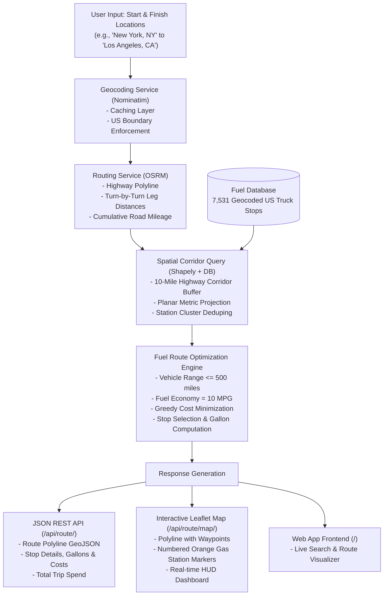

# 🚚 Optimal Fuel Route Planner API (USA)

[](https://python.org)
[](https://djangoproject.com)
[](https://www.django-rest-framework.org/)
[](https://mysql.com)
[](https://project-osrm.org/)
[](https://pytest.org)

An intelligent backend service built with **Django REST Framework (DRF)** that calculates driving routes across the United States, identifies the **cost-optimal fuel stops** along the route based on real-world retail fuel prices, enforces a strict vehicle range limit of **500 miles**, and calculates total fuel expenditure assuming an efficiency of **10 miles per gallon (10 MPG)**.

Includes a **REST API**, a **standalone map endpoint**, and an **interactive Leaflet web dashboard**.

---

## 📋 Table of Contents
1. [System Architecture & Workflow](#-system-architecture--workflow)
2. [Problem Specifications & Vehicle Rules](#-problem-specifications--vehicle-rules)
3. [The Fuel Optimization Engine](#-the-fuel-optimization-engine)
4. [Dataset & Geocoding Pipeline](#-dataset--geocoding-pipeline)
5. [Interactive Web UI](#-interactive-web-ui)
6. [API Documentation & cURL Examples](#-api-documentation--curl-examples)
7. [Installation & Quickstart](#-installation--quickstart)
8. [Database Configuration (MySQL & SQLite)](#-database-configuration-mysql--sqlite)
9. [Deploy for Free on Render](#-deploy-for-free-on-render)
10. [Automated Testing](#-automated-testing)
11. [Repository Structure](#-repository-structure)

---

## 🏗️ System Architecture & Workflow

The entire system operates as a cohesive pipeline from raw user input to optimal route visualization:



### Detailed Workflow Steps:
1. **Input Ingestion & Validation**: Accepts cities, full street addresses, or raw `lat,lon` coordinates. Rejects queries outside the United States.
2. **Road Network Routing**: Calls the free, high-performance **OSRM (Open Source Routing Machine)** public engine to retrieve real highway paths and road network distances.
3. **Spatial Corridor Filtering**: Extracts stations from the database located within **10 miles** perpendicular to the highway polyline, projecting each station to an exact route mile-marker ($0 \to D$).
4. **Optimization Calculation**: Solves the minimum-cost refueling problem (partial fills, tank capacity, and a full starting tank) guaranteeing no leg between refuels exceeds the usable range.
5. **Output Delivery**: Generates structured JSON responses and renders interactive maps with rich tooltips.

---

## 📐 Problem Specifications & Vehicle Rules

| Parameter | Value | Rule / Behavior |
|---|---|---|
| **Geographic Scope** | Continental USA | Both origin and destination must resolve within US borders. |
| **Max Fuel Range** | **500 miles** | Physical tank range on a full tank (50 gal × 10 mpg). |
| **Usable Range** | **475 miles** | Max range − safety margin. No leg between refuels may exceed this. |
| **Fuel Economy** | **10 MPG** | Fuel consumed (gallons) = $\text{Total Distance} / 10.0$. |
| **Tank Capacity** | **50.0 gallons** | $\text{Max Range} / \text{MPG} = 500 / 10 = 50.0\text{ gal}$. |
| **Starting Fuel** | **50.0 gallons (free)** | The vehicle starts with a **full tank**; that fuel is already owned and never billed. |
| **Safety Margin** | **25 miles** | Reserve kept in the tank; the planner never relies on the last 25 miles. |
| **Corridor Width** | **10 miles** | Truckstops further than 10 miles from the highway are excluded. |
| **Optimization Target** | **Minimum Cost** | Minimizes dollars actually spent at stations, not total fuel consumed. |

---

## 🧠 The Fuel Optimization Engine

The core algorithmic challenge is: **How do we guarantee the vehicle never runs out of fuel while picking the cheapest stations along an arbitrary cross-country highway?**

### 1. Planar Projection & Spatial Indexing
Raw GPS coordinates $(\text{lat}, \text{lon})$ lie on a spherical surface where 1 degree of longitude varies with latitude. The optimizer projects coordinates into a locally planar Cartesian coordinate system in **exact miles**:
$$X = (\text{lon} - \text{lon}_{\min}) \times 69.0 \times \cos(\text{lat}_{\text{mean}})$$
$$Y = (\text{lat} - \text{lat}_{\min}) \times 69.0$$
Using **Shapely's `LineString`**:
- The perpendicular distance from a candidate station to the highway is computed in exact Euclidean miles.
- The station is projected onto the route to assign its exact highway mile-marker $d_i \in [0, D]$.

### 2. Candidate Deduplication
At busy interstate highway exits, multiple truck stops often sit adjacent to one another. Stations within 2 miles of each other are clustered, automatically retaining the lowest-priced station at that highway interchange.

### 3. Optimization Logic

The planner solves the classic **minimum-cost refueling problem** with a free full
starting tank, a tank-capacity limit, partial fills, and a 25-mile safety reserve.
It is implemented as an **exact dynamic program** over (station, fuel-level) states,
where fuel is discretized to 0.05 gal. At a station the vehicle may buy any amount up
to the free tank space; a leg is only allowed if it is within the usable range and the
fuel in the tank covers it. The starting fuel is fully usable but never purchased, so
**purchased gallons ≠ consumed gallons**.

- **Consumed gallons** $= D / \text{MPG}$ (whole trip).
- **Purchased gallons** $= \sum \text{gallons bought}$, never more than
  $\text{consumed} - \text{tank capacity}$ across the whole plan.
- **Cost** $= \sum (\text{gallons bought} \times \text{that station's price})$.
- **Weighted average price** $= \text{total cost} / \text{total purchased gallons}$
  (`null` when nothing is purchased).

#### Scenario A: Journeys within the usable range ($D \le 475 \text{ miles}$)
- The full starting tank covers the trip: **0 mandatory stops and \$0 purchase cost**.
- The response may still include an optional, **unbilled** `suggested_stop` (the
  cheapest corridor station); it is never counted as a stop or added to the cost.

#### Scenario B: Longer journeys ($D > 475 \text{ miles}$)
- The DP finds the **globally minimum-cost** set of (possibly partial) purchases.
- No leg between refuels exceeds the 475-mile usable range.
- No single purchase exceeds the 50-gallon tank capacity.
- If no feasible plan exists (e.g. an unavoidable gap wider than the usable range),
  the API returns a clear error — it never returns an infeasible plan.

#### Example Run (New York $\to$ Chicago, 790.6 miles):
- **Stop 1 (Mile 396.9)**: *SHEETZ #639* in Youngstown, OH @ **$3.059/gal** (5.4 gal, $16.52)
- **Stop 2 (Mile 553.8)**: *S&G #88* in Toledo, OH @ **$3.009/gal** (23.7 gal, $71.31)
- **Leg 1**: $0 \to 396.9\text{ mi} = 396.9\text{ mi} \le 475\text{ mi}$ ✅
- **Leg 2**: $396.9 \to 553.8\text{ mi} = 156.9\text{ mi} \le 475\text{ mi}$ ✅
- **Leg 3**: $553.8 \to 790.6\text{ mi} = 236.7\text{ mi} \le 475\text{ mi}$ ✅
- **Fuel consumed**: **79.06 gal** | **Fuel purchased**: **29.10 gal** (the rest comes
  from the free starting tank) | **Total cost**: **$87.83** | **Avg price**: **$3.018/gal**

---

## 📊 Dataset & Geocoding Pipeline

The assignment provided `/Users/ranjitadhikari/Desktop/fuel-prices-for-be-assessment.xlsx` with **8,151 rows** of OPIS retail diesel prices:
`['OPIS Truckstop ID', 'Truckstop Name', 'Address', 'City', 'State', 'Rack ID', 'Retail Price']`.

> [!NOTE]
> The source file contained city and state names, but **no geospatial coordinates (latitude and longitude)**. To enable routing and spatial proximity search, an automated geocoding pipeline was developed.

1. **Pipeline Script**: [`scripts/generate_geocoded_data.py`](file:///Users/ranjitadhikari/Desktop/Personalprojects/BE/scripts/generate_geocoded_data.py)
2. **Sources Merged**:
   - **GeoNames US Postal Data**: 41,000+ US postal divisions with exact coordinates.
   - **SimpleMaps US Cities**: Complete latitude/longitude database for all US incorporated cities and towns.
   - **Alias Expander**: Handles abbreviations (e.g., `St.` $\leftrightarrow$ `Saint`, `Ft.` $\leftrightarrow$ `Fort`, `Mt.` $\leftrightarrow$ `Mount`).
3. **Result**:
   - **100% of US truck stops (7,531 stops)** across all 50 states were successfully geocoded.
   - Saved to [`data/processed/fuel_prices_geocoded.csv`](file:///Users/ranjitadhikari/Desktop/Personalprojects/BE/data/processed/fuel_prices_geocoded.csv).
   - Non-US rows (e.g. Canadian provinces ON, AB, BC) were cleanly filtered out.

---

## 💻 Interactive Web UI

The project comes with a built-in web application served directly from the Django backend at `http://localhost:8000/`.

- **Sidebar Controls**: Input fields for Start and Finish locations, vehicle range (default 500 mi), and fuel economy (default 10 mpg).
- **Interactive Leaflet Map**:
  - Blue polyline showing the exact highway path.
  - Green starting flag and red destination flag.
  - Numbered orange gas pump pins along the route.
- **Stop Cards & Tooltips**: Clicking any station pin or sidebar card displays the station name, street address, fuel price per gallon, mile-marker along the route, gallons filled, and cost.
- **HUD Metric Cards**: Instant summary of Total Distance, Total Fuel Cost, Fuel Purchased, and Number of Stops.

---

## 📡 API Documentation & cURL Examples

### 1. Route Optimization API
Calculate driving route, fuel stops, and fuel cost.

- **Endpoint**: `GET /api/route/` or `POST /api/route/`
- **Headers**: `Content-Type: application/json`

#### Request Parameters:
| Field | Type | Required | Default | Description |
|---|---|---|---|---|
| `start` | string | **Yes** | — | Origin (city/state, address, or `"lat,lon"`) |
| `finish` | string | **Yes** | — | Destination (city/state, address, or `"lat,lon"`) |
| `max_range` | float | No | `500.0` | Vehicle maximum range in miles |
| `mpg` | float | No | `10.0` | Fuel economy in miles per gallon |

#### Example POST Request:
```bash
curl -X POST "http://localhost:8000/api/route/" \
  -H "Content-Type: application/json" \
  -d '{
    "start": "New York, NY",
    "finish": "Chicago, IL",
    "max_range": 500,
    "mpg": 10
  }'
```

#### Example GET Request:
```bash
curl -X GET "http://localhost:8000/api/route/?start=Austin,+TX&finish=Los+Angeles,+CA"
```

#### Sample JSON Response:
```json
{
  "start_location": {
    "query": "New York, NY",
    "display_name": "New York, United States",
    "latitude": 40.7127,
    "longitude": -74.0060
  },
  "finish_location": {
    "query": "Chicago, IL",
    "display_name": "Chicago, Illinois, United States",
    "latitude": 41.8756,
    "longitude": -87.6244
  },
  "total_distance_miles": 790.57,
  "duration_hours": 14.85,
  "total_fuel_gallons": 29.1,
  "total_fuel_consumed_gallons": 79.06,
  "total_fuel_cost_usd": 87.83,
  "avg_price_per_gallon": 3.0183,
  "tank_capacity_gallons": 50.0,
  "usable_range_miles": 475.0,
  "starting_fuel_gallons": 50.0,
  "fuel_stops_count": 2,
  "fuel_stops": [
    {
      "opis_id": 72445,
      "truckstop_name": "SHEETZ #639",
      "address": "I-80 Exit 223",
      "city": "Youngstown",
      "state": "OH",
      "retail_price": 3.059,
      "latitude": 41.0171,
      "longitude": -80.8029,
      "route_mile": 396.9,
      "leg_distance_miles": 396.9,
      "gallons_filled": 5.4,
      "cost_usd": 16.52,
      "note": "En-route refueling stop"
    },
    {
      "opis_id": 72288,
      "truckstop_name": "S&G #88",
      "address": "I-475 Exit 13 & US-20",
      "city": "Toledo",
      "state": "OH",
      "retail_price": 3.009,
      "latitude": 41.6639,
      "longitude": -83.5552,
      "route_mile": 553.8,
      "leg_distance_miles": 156.9,
      "gallons_filled": 23.7,
      "cost_usd": 71.31,
      "note": "En-route refueling stop"
    }
  ],
  "suggested_stop": null,
  "route_geometry": {
    "type": "LineString",
    "coordinates": [[-74.0056, 40.7121], ...]
  },
  "map_url": "http://localhost:8000/api/route/map/?start=New+York%2C+NY&finish=Chicago%2C+IL"
}
```

---

### 2. Standalone Interactive Map View
Returns a full HTML page rendering the route and fuel stop markers in Leaflet:
```
GET http://localhost:8000/api/route/map/?start=New+York,+NY&finish=Los+Angeles,+CA
```

---

### 3. Fuel Stops Directory API
Browse the 7,531 truck stops database with pagination and filters:
```bash
# Query all stations in Ohio with retail price <= $3.10
curl "http://localhost:8000/api/fuel-stops/?state=OH&max_price=3.10"

# Query by city
curl "http://localhost:8000/api/fuel-stops/?city=Dallas"
```

---

### 4. System Health Check
```bash
curl "http://localhost:8000/api/health/"
```
Response:
```json
{
  "status": "healthy",
  "fuel_stops_count": 7531,
  "database_engine": "configured"
}
```

---

## ⚡ Installation & Quickstart

### 1. Prerequisites
- Python 3.10+ (or [uv package manager](https://docs.astral.sh/uv/))

### 2. Setup Virtual Environment
```bash
cd /Users/ranjitadhikari/Desktop/Personalprojects/BE

# Create virtual environment
python3 -m venv .venv
source .venv/bin/activate

# Install dependencies
pip install -r requirements.txt
```
*(Or with `uv`: `uv pip install -r requirements.txt`)*

### 3. Run Migrations & Load Pre-Geocoded Dataset
```bash
# Apply Django migrations
python manage.py migrate

# Seed all 7,531 geocoded truckstops into the database (takes ~1 second)
python manage.py load_fuel_prices
```

### 4. Start Development Server
```bash
python manage.py runserver 8000
```
Open **[http://localhost:8000/](http://localhost:8000/)** in your browser.

---

## 🗄️ Database Configuration (MySQL & SQLite)

The project includes dual-database support:
- **SQLite (Default)**: Automatically configured out-of-the-box for instant local development with zero external daemons.
- **MySQL**: Ready for production deployment using `pymysql`.

To connect to a **MySQL** instance, set the following environment variables:

```bash
export DB_ENGINE="mysql"
export DB_NAME="fuel_routing_db"
export DB_USER="root"
export DB_PASSWORD="your_password"
export DB_HOST="127.0.0.1"
export DB_PORT="3306"

# Run migrations and seed data into MySQL
python manage.py migrate
python manage.py load_fuel_prices
```

When `DB_ENGINE` is unset or set to `sqlite`, the application defaults safely to `db.sqlite3`.

---

## 🚀 Deploy for Free on Render

This repository ships with a [Render Blueprint](https://render.com/docs/blueprint-spec)
(`render.yaml`) plus `build.sh` / `start.sh`, so it deploys as a free Python web
service with no extra configuration.

### How it works
- **`build.sh`** installs dependencies and runs `collectstatic` so **WhiteNoise**
  can serve static assets straight from the WSGI app (no separate static host).
- **`start.sh`** runs migrations, reloads the committed fuel-stop CSV, then
  launches **Gunicorn** on Render's `$PORT`.
- Free instances use an **ephemeral filesystem**, so the SQLite database is
  rebuilt from the committed CSV on every boot — that is why the CSV is the
  source of truth and `start.sh` reloads it each time.

### Deploy steps
1. Push this repo to GitHub (already done).
2. In Render: **New → Blueprint**, pick this repo. Render reads `render.yaml`.
3. When prompted (or in **Dashboard → Environment**), set the `sync: false`
   secrets:
   - `DJANGO_CSRF_TRUSTED_ORIGINS` → e.g. `https://<your-app>.onrender.com`
   - `CARTO_API_KEY` / `API_KEY` → optional; blank falls back to the free OSM basemap
   (`DJANGO_SECRET_KEY` is generated automatically by Render.)
4. Click **Apply**. First deploy takes a few minutes; the app is live at
   `https://<your-app>.onrender.com`.

### Production environment variables
| Variable | Purpose |
| --- | --- |
| `DJANGO_SECRET_KEY` | Cryptographic signing key (**auto-generated** by Render) |
| `DJANGO_DEBUG` | Must be `False` in production |
| `DJANGO_ALLOWED_HOSTS` | Comma-separated allowed hosts (e.g. `.onrender.com`) |
| `DJANGO_CSRF_TRUSTED_ORIGINS` | Full origin(s) for CSRF over HTTPS |
| `DB_ENGINE` | `sqlite` (default) or `mysql` |
| `CARTO_API_KEY` / `API_KEY` | Optional CARTO basemap key |

> **Note:** Render's free tier is intended for demos/hobby projects — it spins
> down after ~15 minutes of inactivity (≈1 min cold start) and the disk is
> ephemeral. For durable storage, upgrade to a paid instance with a persistent
> disk or attach a Postgres database.

---

## 🧪 Automated Testing

The repository includes a comprehensive automated test suite powered by `pytest` and `pytest-django`.

```bash
pytest -v
```

### Test Coverage Highlights:
- **`test_geocoding.py`**:
  - `test_geocode_valid_us_city`: Verifies coordinate accuracy for US cities.
  - `test_geocode_coordinates_input`: Verifies handling of raw `"lat, lon"` queries.
  - `test_geocode_invalid_location_raises`: Validates error responses for nonsensical queries.
  - `test_geocode_international_location_rejected`: Enforces strict rejection of non-US queries (e.g., Tokyo, Japan).
- **`test_optimizer.py`**:
  - `test_optimizer_short_trip`: Verifies that trips $<500$ miles require 0 mandatory stops.
  - `test_optimizer_long_trip_respects_500_mile_range`: Verifies on long trips that **no leg between consecutive stops or to the finish ever exceeds 500 miles**.
- **`test_api.py`**:
  - `test_health_check`: Verifies the `/api/health/` endpoint.
  - `test_route_optimization_api_get`: Verifies GET `/api/route/` calculation and schema.
  - `test_route_optimization_api_post`: Verifies POST `/api/route/` JSON payload execution.
  - `test_route_map_endpoint_returns_html`: Verifies `/api/route/map/` returns rendered HTML map.
  - `test_fuel_stops_list_api`: Verifies filtering and pagination on `/api/fuel-stops/`.

```
============================= 11 passed in 13.23s ==============================
```

---

## 📁 Repository Structure

```
BE/
├── core/                                # Django core project configuration
│   ├── settings.py                      # DB settings (MySQL/SQLite), DRF, CORS
│   ├── urls.py                          # Root URL configuration & frontend view
│   ├── wsgi.py                          # WSGI entrypoint
│   └── asgi.py                          # ASGI entrypoint
├── routing/                             # Main routing & optimization app
│   ├── models.py                        # FuelStop database model with spatial indexes
│   ├── serializers.py                   # DRF request & response serializers
│   ├── views.py                         # API views (Route, Map, FuelStops, Health)
│   ├── urls.py                          # Route URL patterns under /api/
│   ├── services/
│   │   ├── geocoding.py                 # Nominatim geocoder with caching & US validation
│   │   ├── osrm.py                      # OSRM driving route engine & polyline distance
│   │   ├── optimizer.py                 # 500-mile vehicle range fuel cost optimizer
│   │   └── map_service.py               # Leaflet HTML map generator
│   └── management/commands/
│       └── load_fuel_prices.py          # Bulk database seed command
├── data/
│   ├── raw/
│   │   └── fuel-prices-for-be-assessment.csv  # Original OPIS source data
│   └── processed/
│       └── fuel_prices_geocoded.csv     # 7,531 pre-geocoded US fuel stations
├── templates/
│   └── index.html                       # Frontend web dashboard with live Leaflet map
├── static/                              # Static assets (CSS/JS collected by Django)
├── scripts/
│   ├── generate_geocoded_data.py        # Pipeline that geocodes the raw source data
│   └── run_case_tests.py                # Manual end-to-end case-runner script
├── tests/                               # Pytest test suite
│   ├── conftest.py                      # Test database auto-seeding fixture
│   ├── test_api.py                      # API endpoint integration tests
│   ├── test_geocoding.py                # Geocoding unit tests
│   └── test_optimizer.py                # Fuel optimization & 500-mile range tests
├── .env.example                         # Sample environment variable configuration
├── requirements.txt                     # Pinned project dependencies
├── pytest.ini                           # Pytest configuration
├── manage.py                            # Django management CLI
└── README.md                            # Complete documentation & workflow guide
```

---

## 📄 License
This project is open-source and available under the [MIT License](LICENSE).
